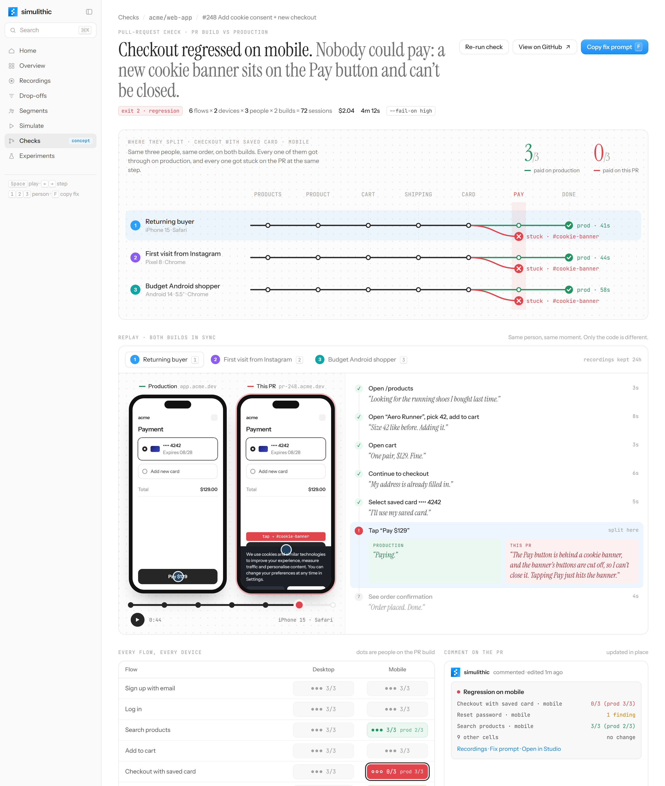
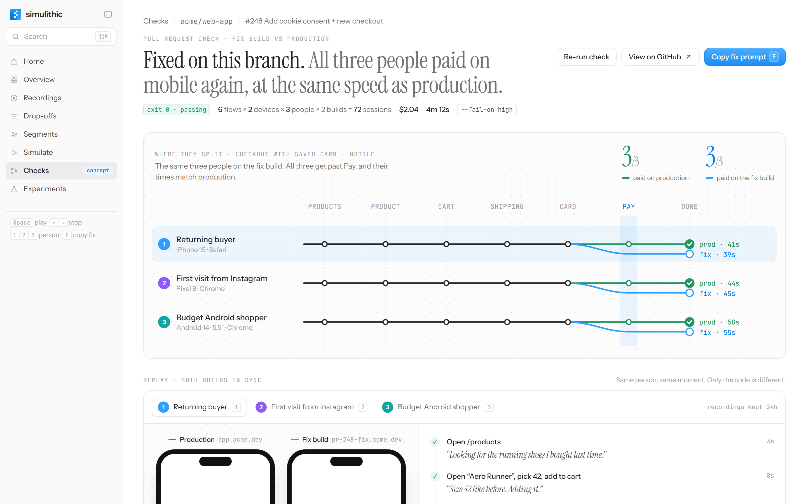

# Simulithic · Check result concept

An unsolicited design concept for the one Simulithic Studio screen I couldn’t find in any public demo: the result of a pull-request check.

Built from the [Simulithic docs](https://www.simulithic.com/docs) and the Studio demos the founders have posted. The scenario, people and numbers are invented.



## The idea

A Simulithic check sends the same simulated people through the same flows on the PR build and on production. The story is where those two runs part ways, so the page is built around that split.

- **Lead with the verdict.** The title is the diagnosis, with the exit code next to it. Someone arriving from the PR comment knows what broke, where and why without scrolling.
- **Where they split.** Each person is a line through the checkout steps. Production carries on to “Done”; every PR line breaks off at “Pay”.
- **Two phones, one moment.** Production and the PR replay side by side, in sync. The same tap succeeds on one and lands on the cookie banner on the other.
- **People, not test cases.** Every step carries the person’s own thought. At the failing step, both builds’ thoughts sit next to each other.
- **Close the loop in place.** A finding ends with a fix prompt and “Verify fix”, which re-runs the same three people. The red branches redraw in blue and the verdict updates.



## Try it

- Press **Space** to play the replay, **← →** to step, **1 2 3** to switch person, **F** to copy the fix prompt.
- Hover a finding to see which cells and people it hit.
- Click **Verify fix**, or open the page with `#fixed` to start in the fixed state.

## Design choices

- Matches the Studio rather than the marketing site: the left sidebar and its sections, serif page titles (Instrument Serif), Instrument Sans for interface text, and small uppercase mono labels.
- Brand blue `#2D9FFE` and the gradient buttons from simulithic.com.
- Only “Checks” is live in the sidebar; the other sections are shown for context and are not interactive.
- Works down to phone width: the two replay phones scale to sit side by side.

## Stack

React 19, TypeScript, Vite and Tailwind CSS v4. No other runtime dependencies.

```
src/
  components/
    check/            page sections: header, split map, matrix, PR comment, findings, toast
      replay/         synced phones, timeline and step list
    layout/           sidebar and compact top bar
    ui/               button, card, chip, kbd, section, icons, logo
  data/check.ts       the check being shown: flows, people, steps, fix prompt
  hooks/              clipboard, keyboard shortcuts, element height, scroll position, window width
  state/              reducer, context and provider for playback, selection and the fix flow
  types.ts
```

## Run locally

```bash
npm install
npm run dev
```

`npm run build` type-checks and builds; `npm run lint` runs oxlint.

---

Not affiliated with Simulithic. The Simulithic name and logo belong to Simulithic.
